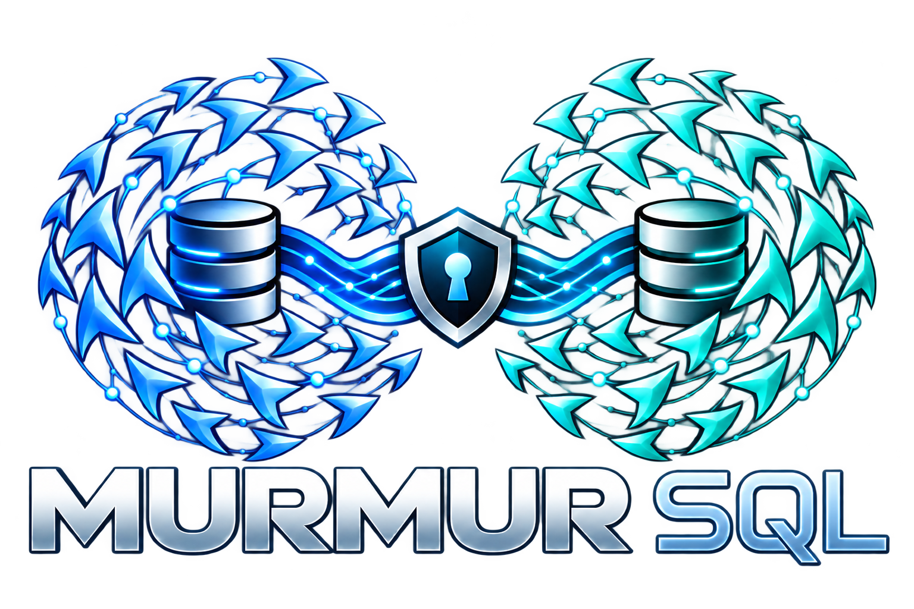

# Murmur-SQL

One in-memory SQLite database with SQLite session capture, encrypted background
persistence in Murmur Spool, and per-column last-writer-wins conflict metadata.

```rust
use sqlite_session::{Database, Migration, OpenMode, Options};

let db = Database::open("./data", [7u8; 32], Options {
    mode: OpenMode::CreateNew,
    ..Options::default()
})?;
db.migrate(Migration::new(
    "CREATE TABLE items(id INTEGER PRIMARY KEY, value TEXT NOT NULL)"
))?;
db.transaction(|sql| {
    sql.execute("INSERT INTO items VALUES(1, 'hello')", [])?;
    Ok(())
})?;
db.flush()?; // Wait for a durable checkpoint.
db.close()?;
# Ok::<(), sqlite_session::Error>(())
```

Reopen with `OpenMode::Existing` (the default) and the same application-provided
32-byte key. An incorrect key returns `Error::WrongKey` before storage is changed.
`CreateNew` requires a new storage directory; it never replaces an existing one.
Passphrase derivation and alternate encryption ciphers are not implemented.

## Write path

Application transactions execute SQL on the sole SQLite connection. SQLite's
session extension records their changes. There are no CRDT tables, triggers, or
metadata statements on that connection, and no second SQLite database.

At a collection boundary, the crate extracts the committed changeset, assigns
its collection-time HLC version, starts a fresh session, and queues the batch.
Extraction requires a brief pause on the connection. The background worker then:

1. Iterates the changeset to find row keys and changed columns.
2. Reads existing versions and tombstones from Spool.
3. Commits the changeset, updated metadata, and clock in one atomic Spool group, using Zstd compression followed by AES-256-GCM encryption.

All changes within an extracted batch share a version. The version is assigned
before queueing; a delayed or retried worker keeps that original version. The logical counter prevents clock regression and the node ID provides a tie-break.
Spool is the authoritative metadata store. Rust holds transient record payloads while processing a batch, plus a small clock watermark; it maintains no separate metadata map or SQL replica. Spool's existing memory index stores key locations,
not metadata values. Spool also has a bounded cache of frequently read blocks;
this is disposable cached data, and Spool remains authoritative.

Transactions acknowledge **in-memory commit**, not disk durability. Call `flush`
when durability is required. The default five-second collection schedule gives an approximate loss window; busy callbacks or slow storage can extend it.

## Settings at open

| Option | Default |
| --- | --- |
| Encryption algorithm | AES-256-GCM (fixed; no algorithm option exposed) |
| `key` argument to `Database::open(path, key, options)` | Required application-provided 32-byte key; no default |
| `capture_interval` | 5 seconds |
| `capture_bytes` | 8 MiB |
| `queue_bytes` | 64 MiB |
| `transaction_bytes` | 64 MiB |
| `compression_level` | Zstd level 3 |
| `segment_bytes` | 256 MiB |
| `spool_block_bytes` | 64 KiB |
| `spool_cache_bytes` | 32 MiB (zero disables) |
| `snapshot_deltas` | 128 checkpoints |
| `snapshot_bytes` | 256 MiB of checkpoint records |
| `storage_workers` | 2 Spool workers |

The encryption key is the second argument to `Database::open`, outside `Options`.
Supply the same key when reopening the directory. AES-256-GCM encrypts Spool
blocks; the application key protects Spool’s stored data keys. Passphrases and
selectable encryption algorithms are not exposed by this crate.

The capture threshold is checked between transactions. The transaction limit
bounds the active session's reported memory/changeset size before commit; it is
not a hard cap on temporary allocations during a SQL statement. Queue accounting
covers captured payloads, not every allocator or disk framing byte. Serialized
log and snapshot records are limited to 512 MiB. Queue settings allow at most
128 MiB. Snapshot compaction also uses temporary buffers proportional to the
stored changesets it compacts.

A full queue returns `Error::Busy`. Storage failure stops further writes while
leaving reads available, retains pending batches, and appears in `status()`.
After resolving the storage problem, call `retry_storage()`. `close()` flushes
and reports errors; explicit close is recommended over relying on drop.

## Observability, Spool metrics, and write backpressure

Murmur provides real-time diagnostic metrics and structured progress interfaces so applications can monitor database internals, track reload progress, and proactively pace write workloads before hitting queue capacity limits (`Error::Busy`).

### Structured reload progress

When opening a database or recovering after restart, applications can observe reload phases (`Opening`, `Rebuilding`, `Indexing`, `Finalizing`, `Ready`, `Failed`) using `options.on_open_progress`:

```rust
use sqlite_session::{Database, OpenPhase, Options};
use std::sync::Arc;

let mut opts = Options::default();
opts.on_open_progress = Some(Arc::new(|p| {
    println!(
        "[{:?}] {:.1}% complete - table: {:?}, rows: {}/{}",
        p.phase, p.percent, p.current_table, p.rows_processed, p.rows_total
    );
}));

let db = Database::open("./data", [7u8; 32], opts)?;
assert_eq!(db.open_progress().unwrap().phase, OpenPhase::Ready);
```

### Metrics inspection

Applications can query in-memory SQLite and on-disk Spool persistence metrics without acquiring write locks or blocking SQLite queries:

```rust
// SQLite in-memory engine metrics (memory usage, page count, rows, tables, capture memory)
let sqlite = db.sqlite_metrics()?;
println!("SQLite RAM: {} bytes across {} tables ({} rows)", sqlite.memory_used_bytes, sqlite.table_count, sqlite.total_rows);

// Spool persistence engine metrics (disk usage, compression, buffer depths, block commits)
let spool = db.spool_metrics();
println!("Spool disk footprint: {} bytes across {} segments (ratio: {:.2}x)", spool.disk_bytes, spool.segments, spool.compression_ratio);

// Consolidated snapshot
let status = db.status();
println!("Committed: {}, Durable: {}, Pending Queue: {} bytes", status.committed, status.durable, status.pending_bytes);
```

### Understanding `capture_interval` and write buffer growth

The frequency at which background checkpoints run is governed by `options.capture_interval` (default: **5 seconds**):

- **Expected buffer accumulation**: When transactions commit, SQLite changesets accumulate in memory during the collection window. If `capture_interval` is set to 5s, the pending session buffer (`status.pending_bytes`) is **expected to continuously grow** across those 5 seconds as writes arrive.
- **Collection boundary**: Only when the timer elapses (or an explicit `db.flush()` is called) does Murmur capture the accumulated changeset, advance the collection clock, and hand the payload off to the background Spool storage worker to compress, encrypt, and fsync to disk.
- **Tuning trade-off**:
  - Setting a lower interval (e.g. `Duration::from_millis(500)`) flushes to disk more frequently, reducing the in-flight buffer size and narrowing the crash-loss window at the cost of higher Spool block/sync overhead.
  - Setting a higher interval batches writes more efficiently into larger Zstd blocks, but requires `options.queue_bytes` to accommodate the entire burst of writes generated across that interval.

### Monitoring Spool to pace writes and back off

Murmur commits transactions to SQLite in memory immediately and buffers changesets in a bounded background persistence queue (`options.queue_bytes`, default 64 MiB). If write volume during a collection interval exceeds `queue_bytes`, or if background Spool writes and disk flushes fall behind, incoming writes fail with `Error::Busy`.

Applications can monitor `db.status().pending_bytes` alongside `db.spool_metrics()` to apply adaptive backpressure or back off before rejections occur:

```rust
use sqlite_session::{Database, Error, Result};
use std::{thread, time::Duration};

fn execute_with_backpressure<T>(
    db: &Database,
    queue_budget: usize,
    mut txn: impl FnMut() -> Result<T>,
) -> Result<T> {
    loop {
        let status = db.status();

        // 1. Proactive backpressure: check Murmur's checkpoint queue fill level
        if status.pending_bytes > (queue_budget * 3 / 4) {
            // Queue is over 75% full: slow down writes to allow Spool worker to catch up
            thread::sleep(Duration::from_millis(20));
            continue;
        }

        // 2. Proactive backpressure: check Spool's internal write stage queue
        if let Some(spool) = status.spool {
            if spool.pending_bytes > (queue_budget as u64 / 2) {
                // Spool block sealing/crypto queue is backed up
                thread::sleep(Duration::from_millis(15));
                continue;
            }
        }

        // 3. Execute transaction with retry on busy
        match txn() {
            Err(Error::Busy) => {
                // Queue full or storage write collision: back off and retry
                thread::sleep(Duration::from_millis(50));
            }
            other => return other,
        }
    }
}
```

## Schema, recovery, and offline merging

Tables need non-null declared primary keys. Composite keys and `WITHOUT ROWID`
are supported. Nonunique indexes are supported; foreign keys, CHECK constraints,
non-primary unique constraints, unmanaged virtual tables, views, and application triggers
are currently rejected. Use `migrate()` for schema changes. Explicit
`TableMapping` entries preserve identities when renaming tables or columns.
Primary-key identity cannot change.

## FTS5 and vector search with replication

Murmur manages local, rebuildable search indexes over ordinary source tables.
Write text and embeddings to the source table; query the virtual index with
normal FTS5 or `vec0` SQL. Source rows use the existing SQLite session capture,
encrypted Spool persistence, conflict resolution, and peer replication. Search
indexes reflect the resolved local rows, including deletions and local-only
tables. Their contents and internal shadow tables are never replicated.

```rust,no_run
use sqlite_session::{Database, Fts5Index, Migration, OpenMode, Options};

let db = Database::open("./search-db", [7; 32], Options {
    mode: OpenMode::CreateNew,
    search_indexes: vec![Fts5Index::new(
        "documents_fts", "documents", vec!["title".into(), "body".into()],
    ).into()],
    ..Options::default()
})?;
db.migrate(Migration::new(
    "CREATE TABLE documents(id INTEGER PRIMARY KEY, title TEXT, body TEXT)",
))?;
db.transaction(|sql| {
    sql.execute("INSERT INTO documents VALUES(1001, 'Murmur', 'Replicated search')", [])?;
    Ok(())
})?;
db.refresh_indexes()?;
let id: i64 = db.read(|sql| Ok(sql.query_row(
    "SELECT rowid FROM documents_fts WHERE documents_fts MATCH 'replicated'",
    [], |row| row.get(0),
)?))?;
assert_eq!(id, 1001);
# Ok::<(), sqlite_session::Error>(())
```

Enable the optional `vector` Cargo feature for sqlite-vec. Configure a
`VectorIndex::new("documents_vec", "documents", "embedding", 768)` alongside
FTS5. Its source column must be declared `BLOB`, containing exactly 768 finite
little-endian float32 values; `NULL` excludes a row from vector search. Vector
column names must be ASCII identifiers starting with a letter. The default
distance is L2; `DistanceMetric::Cosine` and `DistanceMetric::L1` are also supported.
For example, query `SELECT rowid, distance FROM documents_vec WHERE embedding
MATCH ? AND k=10 ORDER BY distance`, binding a vector BLOB or JSON vector string.
Murmur stores the supplied embeddings and does not generate them.

Indexed source tables require one declared `INTEGER PRIMARY KEY`. Assign IDs
uniquely across writers; independent SQLite-generated row IDs can collide between
peers. FTS5 source columns must be declared `TEXT`. FTS5 uses its normal content
storage, trading additional memory for simple deferred updates without retaining
old document text. Built-in tokenizer options are `unicode61` (default), `ascii`,
`porter`, and `trigram`.

Indexes live in the same connection's temporary schema, with `temp_store=MEMORY`
so index pages stay in RAM. Definitions are
node-local: provide them in `Options.search_indexes` on every open. Opening an
existing database rebuilds them before queries start. New databases may configure
indexes before their source tables are created or adopted from a peer. Backups
contain authoritative source data; restore and reopen with the desired index
definitions. `db.set_search_indexes(definitions)` replaces definitions atomically
and rebuilds them, and an empty list removes managed indexes. Remove/reconfigure
indexes before migrating away their source tables or indexed columns.

Ordinary searches may lag by the capture interval plus maintenance time.
`db.refresh_indexes()` collects pending writes and waits for local indexing; it
does not wait for peer delivery or disk durability. `db.flush()` controls source
durability and does not imply index freshness. Maintenance runs between requests
on the SQLite owner thread, never inside ordinary application transactions.
Defaults are an 8 MiB work budget, 256 rows per turn, and a 100 ms maintenance
interval (`search_queue_bytes`, `search_batch_rows`, `search_interval`). Queue
overflow discards work and rebuilds affected indexes. Initial rebuilds and index
clearing can pause access; background population is batched.

`db.status().search_indexes` reports readiness, rebuilds, pending keys, shared
queued changeset bytes, and errors. Managed indexes and their shadow tables reject
application writes. Searches against rebuilding or failed indexes return an
authorization error; source writes remain available. Failed maintenance retains
work for retry. Repair invalid source data and call `refresh_indexes()` again.
If an index rebuild fails during open, reopen without that definition, repair the
source data, then use `set_search_indexes()` to restore the index.
Index publication notifies subscriptions; watch the virtual table name to receive
search updates after indexing.

Schema migrations are separate ordered records because sessions do not capture
DDL. Migrations inspect rows before and after their SQL to preserve versions of
unchanged cells and stamp transformed cells. This scan is confined to explicit
migrations, rather than ordinary writes, and can pause a large database.

Recovery replays a compacted changeset archive and later committed log entries
into the one application database. Metadata remains in Spool. Snapshot publication
is durable before covered log records are removed. Compaction combines changesets
within a schema epoch; schema transitions and their earlier replay dependencies
are retained. It does not require a duplicate live database or a live row mirror.

`export_state()` and `merge_state()` support offline state exchange between replicas
with identical database IDs and schema history. Export explicitly reads current
SQL rows and combines them with Spool metadata. The worker computes the LWW join;
accepted row changes are then applied in one application-database transaction.
These explicit operations can pause the connection and allocate complete state
buffers. Each replica must have its own node ID. Network transport is deferred.

Sessions report net changes. Repeated updates collapse into a final update, an
insert followed by delete can disappear, and delete/reinsert within one capture
can become an update. Such a reinsert cannot acquire a distinct generation from
session data alone. Collect the deletion first if that distinction is needed.
Operation-based counters or sets need additional operation capture.

## Backup and restore

`db.backup("./backup")` takes an online, encrypted, point-in-time copy via
Spool's consistent checkpoint. It flushes durable state first; writes after the
checkpoint are not included. The destination must be a new directory. Same
filesystem destinations stay as hardlink checkpoints; cross-filesystem
destinations copy through a temporary sibling checkpoint.

`Database::verify_backup("./backup", key)` checks a backup opens and rebuilds
without mutating it. `Database::restore("./backup", "./restored", key)` copies
to a new live directory and verifies the copy before returning. Restore never
overwrites an existing directory. Backups keep the live encryption key; a wrong
key returns `Error::WrongKey`.

`Database::restore_with_options(..., RestoreOptions { new_database_id,
new_node_id })` clones with fresh identity. Keep the database id and set a
distinct node id to reseed a new replica of the same database. Set a new
database id for an independent copy. Retention is caller-managed: each backup is
an independent directory, delete old ones to prune.

## Minimal helpers and benchmarks

`open_in_memory()` and `start_session()` remain available for session-only use.
The independent benchmark crate is in [tests-benchmark](tests-benchmark/README.md). Its
`persistence` binary compares plain SQLite, session capture, and the managed
crate with collection deferred or background persistence enabled. Earlier
measurements made with synchronous CRDT stamping do not describe this design.

### Spool point reads

Atomic commits may span many independently compressed and authenticated blocks.
Small records are grouped into approximately 64 KiB plaintext blocks, rather than
one large encrypted checkpoint. Changeset and snapshot payloads use 64 KiB
chunks. A record larger than the block target gets a dedicated larger block;
reading a large individual value still requires decoding that value's block.
Existing larger blocks remain readable; these settings affect newly written blocks.

Spool admits a block into its cache after a second read. Least recently accessed
blocks are evicted within the byte budget, and oversized blocks bypass the cache.
The cache retains the compressed encrypted frame and the decoded body with record
offsets, so a hot point read avoids disk I/O, decryption, decompression and parsing.
Decoded buffers are wiped when released. This cache lives in Spool, outside SQLite.

## File operations

Enable the `replication` Cargo feature and set
`options.replication.as_mut().unwrap().files = Some(FileConfig::new(directory,
file_key, fetch_bind))` before opening the database. `FileConfig` and
`FileMetadata` are exported directly by `sqlite_session`.

File operations are available directly on `Database`:

```rust,ignore
let uploaded = db.upload_file("reports/report.pdf", std::fs::File::open("report.pdf")?)?;
let matches = db.search_files("report")?;
let metadata = db.file_metadata("reports/report.pdf")?;
db.get_file("reports/report.pdf", std::fs::File::create("download.pdf")?)?;
```

`list_files()` lists nondeleted files; `search_files(query)` filters names by a
case-sensitive substring, with an empty query listing all files. These return
metadata even when a remote payload is not yet available locally. Use
`file_available(name)` to check local availability. `file_availability(name)`
reports `Local`, recently observed remote peers, or `Unavailable`.
`get_file(name, writer)`
streams decrypted contents and reports an error when the payload is unavailable.
`delete_file(name)` publishes a deletion tombstone. All methods return an error
when file storage is not configured or the database is closed. File operations
use the object store and Spool without executing SQL on the SQLite writer.
`file_key_rotation_status()` reports old-generation objects, missing old-generation
payloads, staged fetches, and whether the previous key is unused in this local
store. Coordinate key retirement across every replication peer.

When High/Low bridge and file storage are both configured, the Low exporter
automatically sends available file contents in bounded, recipient-sealed bridge
bundles. The High receiver verifies the complete content and encrypts it with
its own configured file key before publishing local metadata. Transfer offsets
are durable in Spool and resume after restart. A receiver needs enough
`bridge.staging_bytes` capacity for the file being transferred. Old object
generations are re-encrypted in the background when the file configuration is
reopened with the new key, incremented generation, and previous key; unreferenced
objects are collected after a seven-day grace period.

## Table replication settings

```rust,ignore
db.SetReplication("private_notes", false)?; // Durable locally; row changes stay local.
db.SetReplication("shared_items", true)?;
// Idiomatic Rust spelling is also available:
db.set_replication("shared_items", true)?;
let enabled = db.replication_enabled("shared_items")?;
```

Tables default to enabled. The setting is local to this node and is saved as
`00/schema/replication` in encrypted Spool storage, atomically with the schema
manifest. It survives reopening, backups and schema renames using stable table
IDs. Tables created after a drop default to enabled. No configuration SQL, CRDT
tables or triggers are added to SQLite.

Changing the setting flushes pending local changes under the previous setting
and waits until the new setting is durable. Disabled tables still use session
capture and local persistence, but their new rows, deletes and CRDT records are
excluded from outgoing replication snapshots and batches. Incoming changes to
disabled tables are ignored when applying replicated state. Table definitions
remain shared for schema compatibility; this is a row-data setting.

Enabling a table publishes its current locally persisted rows, tombstones and
causal policy state when networking is enabled. It does not automatically replay
remote changes ignored while disabled. Previously published signed history and
peer copies are retained; disabling does not retract data already replicated.
The methods also work without networking, so settings can be prepared before
replication is configured. Unknown tables return an error.

## Schema replication authority (master)

One node may act as the schema master. Set `master = true` and
`schema_master = Some(own node id)` on that node, and
`schema_master = Some(master id)` on every other node (the id must have a key
in `trusted_origins`). The master signs its canonical schema (tables plus
indexes, local-only tables excluded) with its Ed25519 origin key and pushes it
to divergent peers; receivers verify the signature and the monotonic sequence
number, then adjust their schema. Replays and manifests from anyone else are
recorded for payload filtering but never adopted, and the master never adopts
remote schemas.

Adoption is additive only: new tables, new nullable non-primary-key columns,
and new indexes. Drops, renames, type changes, and primary-key changes are
rejected loudly; make those by migrating the master and letting peers adopt
each additive step, or migrate every node manually. Replicated DDL must
originate on the master: a non-master that creates a replicated table will see
its own writes stop applying upstream until the master carries the same
definition. Receiver-local tables (replication disabled) are never created,
altered, or dropped by adoption, and each sender's latest signed manifest lets
receivers keep applying old transactions that reference tables the sender has
since retired.

Without `schema_master` the previous symmetric behavior applies: any trusted
origin's signed schema can be adopted. Subset filtering needs at least one
direct session per sender; purely gossiped history from never-contacted senders
keeps strict checking.

## Replication history retention

Configure these fields on the replication `Config` supplied at open:

| Setting | Default |
| --- | --- |
| `retention` | 1 hour minimum history age |
| `minimum_retained` | 1,000 transaction records per origin |
| `maximum_offline` | 7 days |
| `retention_interval` | 60 seconds |

Both minimum limits must be exceeded before a log entry is eligible. Within the
offline window, every admitted, unretired peer must acknowledge that entry. After
the window expires, that peer's acknowledgement stops blocking cleanup; it may
need a full snapshot to catch up. Configure `trusted_snapshot_sources` explicitly
on the receiving node to permit that recovery. Disconnecting or suspecting a peer
does not retire it. Peer acknowledgements and retirement survive restart in Spool.

A pass first publishes a durable recovery snapshot covering the applied history.
Log deletions, receipt deletions, retained-history bounds and permanent duplicate
sequence floors then commit atomically. Current rows, conflict versions and CRDT
delete tombstones are preserved. High/Low export progress pins entries that have
not yet been copied to the durable encrypted outbox. Pending outbox artifacts are
retained separately. This policy does not delete backups or current application
rows and is not a hard disk quota.

Each pass deletes at most 256 logs per origin and 2,048 logs overall. Age is
measured from local durable persistence, not a remote HLC. Existing entries with
no recorded persistence time receive a conservative new retention start time.
Physical disk space becomes available through Spool reclamation on each collection cycle;
retained backups can still reference old segment files. All cleanup runs outside
SQLite. New appends are rechecked on the storage worker before updating log bounds.

Direct administrative methods are available on `Database`:

```rust,ignore
let status = db.retention_status()?;
let deleted = db.collect_retention()?; // Run a bounded pass using configured limits.
db.retire_peer(peer_node_id)?;         // Durable, permanent exclusion.
```

These methods require replication and must be called outside SQL callbacks.
Retiring a peer releases its retention obligation and rejects subsequent
connections from that identity. `retention_status()` exposes durable peer
acknowledgements, retired flags, the last collection time and total deleted logs.

### Resumable peer snapshots

When a peer cannot recover from retained transaction history, it requests a full
replicated-state snapshot from an explicitly configured `trusted_snapshot_sources`
node. Protocol version **9** requires a coordinated upgrade of every peer; version
8 peers are rejected. Existing databases remain readable. Incomplete version 8
snapshot staging is discarded because those transfers have no durable donor ID.

The donor atomically stores an immutable signed manifest, 64 KiB chunks and a
history-retention pin in encrypted Spool. The manifest binds the database, donor,
recipient, schema, payload and chunk hashes, and applied-progress boundary.
Either peer can reopen and resume the same transfer. Missing chunks are requested
in pages of at most 128; duplicate chunks are harmless and conflicting data is
rejected. Resume uses the original donor. If its transfer has expired or is
unavailable, the receiver requests a fresh snapshot. A schema mismatch explicitly
cancels an unapplied transfer before negotiating schema and starting again.

| Replication configuration | Default |
|---|---|
| `snapshot_bytes` | 512 MiB maximum individual snapshot payload |
| `snapshot_staging_bytes` | 512 MiB aggregate payload budget for each of incoming and outgoing staging |
| `snapshot_transfer_lifetime` | 7 days, without automatic renewal |
| `staging_transfers` | 4,096 maximum outgoing pins and retained incoming completion receipts |

One incoming transfer runs at a time. Chunk reclamation runs in bounded batches;
leftover chunks count toward the staging budget until reclaimed. Manifest metadata
is additional to the payload budget. Peer queues must allow at least 1 MiB so a
maximum-size manifest fits. Reducing limits can prevent existing transfers from
resuming; restore compatible limits or allow the transfer to expire.

The receiver merges through existing conflict resolution, preserving local-only
tables and concurrent local edits. Applied progress and a completion receipt
commit durably with the merged state before acknowledgement. Receipts survive
reopening and remain available for one transfer lifetime after completion.
Snapshots include file metadata; encrypted file contents use normal peer fetching.

The donor retains post-snapshot history while transferring. After a durable
completion acknowledgement, it freezes a catch-up target at its current applied
progress. Payload chunks can then be reclaimed, but the retention pin remains
until the recipient's durable progress ACKs cover that target or the original
transfer lifetime expires. Peer retirement does not bypass a live transfer pin.
Retention rechecks these pins on the serialized Spool worker before pruning.
Expired transfers require a fresh snapshot; they cannot extend their lease by
reconnecting. No transfer metadata or maintenance SQL is added to SQLite.

The [embedded Go client](clients/go/README.md) wraps the full public Rust surface
through cgo, with local builds and Linux/macOS/Windows CI. See its
[API coverage](clients/go/API-COVERAGE.md) and [runnable example](clients/go/examples/basic/main.go).
